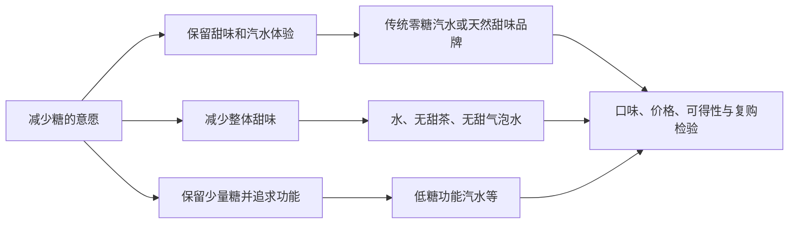

# 无糖饮料的需求、供给与利润归属

研究截止日：**2026-10-21**。以美国为主，英国用于观察较成熟的减糖市场，中国用于观察无甜味茶饮的替代路径。本报告承接 [Zevia 投资研究](../companies/US/ZVIA-zevia/Zevia-investment-research-2026-10-21.md)，回答行业需求能否转化为可持续利润，不重做个股估值。

同日后续专题：[Zevia产品力与复购](../companies/US/ZVIA-zevia/Zevia-product-repeat-moat-2026-10-21.md)，补充购买面板、零售/电商价格与评论、社交正反证及四品牌配方比较。

证据分为 **FACT（源事实）、COMPANY_CLAIM（公司主张）、CALC（计算）、JUDGMENT（判断）、ASSUMPTION（假设）、UNRESOLVED（未解决）**。文中表格的地域、期间、数量/金额、零售/出货口径不可互换。原始文件按本轮授权直接在线阅读，不落地保存；来源目录附原始网址及定位。

发布状态：**PARTIAL**。方向性判断有消费者调查、实际销量、政府政策和公司披露交叉支持；美国严格零糖饮料的统一市场总量、同店动销、家庭复购及全国可比实际成交价，仍缺少完整公开数据。本报告不以付费市场报告的摘要 CAGR 填补这些缺口，也没有独立 Agent 复核。

## 研究结论

**无糖化值得长期研究，但“控糖消费者增加”不足以推出“无糖饮料品牌普遍赚钱”，更不足以直接推出 Zevia 的投资价值。** 我对需求方向偏正面，对供给稀缺性和独立品牌的普遍定价权保持审慎。

有六项决定投资结论的发现：

1. **需求首先是减少糖，并非增加代糖。** IFIC 2025 调查中，75%的美国受访者在限制或避免糖；在这一人群中，55%以水替代含热量饮料，25%在有选择时买无糖产品。两者为多选，不能相加。水、无甜茶和零糖汽水争夺的是同一部分消费预算。[S004][S005，PDF 第68、75页]
2. **消费者最终仍用口味、价格和方便作决定。** IFIC 2026 美国调查的购买影响因素中，口味88%、价格78%、方便61%、健康56%。这些是全部食品饮料的自述影响程度，不是零糖汽水购买权重；它们说明健康标签仍要通过日常购买的检验。[S006，PDF 第25页]
3. **实际增长存在，且巨头也是受益者。** Coca-Cola Zero Sugar 全球等量箱销量2023、2024、2025年分别增长5%、9%、14%，2026Q2增长16%；这证明传统品牌能够承接零糖替代，并未证明消费者必然离开传统品牌。[S007–S010]
4. **供给的主要竞争点正转向商业执行。** 配方和代工有商业供应，巨头通过新品和收购进入相邻赛道。更难获得的是能在促销结束后持续卖货的货架、冷柜与补货系统。Celsius 在2026Q2披露，冷柜扩位需要零售端资本与人工投入，落地慢于 SKU 调整。[S020–S022][S024–S028]
5. **低糖功能汽水既可能扩大需求，也会分流严格零糖品牌。** Circana 所述 modern soda 约18亿美元、同比增长83%，包含功能和低/无糖诉求，不能称为严格零糖市场。Pepsi Prebiotic Cola 每罐含糖5克，依然可以争夺“更健康汽水”的购买理由。[S011][S021]
6. **对 Zevia，这轮行业研究没有提供抬高长期增长假设的充分理由。** 它有“零糖、甜菊糖苷、统一品牌”的明确位置，却同时承受传统零糖汽水、无甜饮品和低糖功能汽水的竞争。关键证据应是销量、复购、扣促销后的单位贡献和现金，而非赛道热度。[S025][S026；JUDGMENT]

我的基准判断是：**无糖占比继续提高，增长在子品类和品牌间分化，利润更多由口味接受度、渠道效率和复购决定。** 目前没有足够证据把行业描述为“总需求爆发且供给短缺”。

## 一、研究边界：先把容易混在一起的市场拆开

### 1. 无糖是一项配方属性，不是统一的消费场景

| 子市场 | 消费者主要任务 | 典型替代对象 | 无糖的作用 | 对 Zevia 的关系 |
|---|---|---|---|---|
| 保留甜味的零糖汽水 | 想喝汽水，同时减少糖和热量 | 含糖汽水、其他零糖汽水 | 核心购买理由之一 | 最直接的市场与竞争 |
| 不加甜味的水、气泡水、茶、黑咖啡 | 解渴、佐餐、清爽、习惯性饮用 | 甜饮料、瓶装水、自制饮品 | 常是产品本身属性 | 间接替代，可分走控糖需求 |
| 零糖能量、运动/电解质饮料 | 提神、运动、补水等特定任务 | 咖啡、传统能量/运动饮料 | 在功能需求上增加一个筛选条件 | 不能把整类增长映射给零糖汽水 |
| 低糖功能/益生元汽水 | 甜味享受，加上成分或功能叙事 | 汽水，也可能是康普茶、果汁、气泡水 | 减糖即可，不一定零糖 | 争夺相邻预算、货架和品牌注意力 |
| 无添加糖的果汁或含汁饮料 | 果味、原料或“少加工”感知 | 果汁、汽水、其他健康饮料 | 无添加不等于总糖为零 | 标签认知竞争，不能并入严格零糖 |

以上是 **JUDGMENT：消费任务分类**，不是互斥的行业统计分类。同一个品牌可以同时占据多个位置，同一个消费者也可以跨类购买。

**FACT：**美国 FDA 对普通食品的 sugar-free 声称要求包括：每参考食用量和每标签份量的糖均低于0.5克，并满足其他条件；不自动等于低热量。中国 GB 28050—2011 的无糖标准为每100克或100毫升不超过0.5克，低糖为不超过5克。两国分母不同，不能只比较包装上的“0”。[S001][S002，附录C表C.1]

**FACT：**Pepsi Prebiotic Cola 的官方配方为每12盎司罐30千卡、糖5克、益生元纤维3克；Simply Pop 官方称含25%–30%果汁、无添加糖、纤维6克。它们代表相邻需求的供给创新，而非“整个汽水已无糖化”的证据。[S021][S022] Target 一个 Poppi 8罐装商品的营养信息列示每份糖5克、添加糖4克；这是具体 SKU 的标签，不代表全品牌所有口味。[S023]

### 2. 为什么不能简单加总市场规模

零糖汽水、零糖能量饮料、无糖茶的消费场景可以重叠；modern soda 又可能包含零糖汽水。把各家报告的市场规模相加会重复计算，把瓶装水全部算成 Zevia 的目标市场则会忽略消费者不需要甜味这一事实。

本报告采用两层边界：**窄口径观察严格零糖甜味汽水的替代，宽口径观察所有争夺控糖预算和货架的饮品。** 前者用于判断 Zevia 的直接空间，后者用于判断它的竞争压力。宽口径机会大，不代表单一品牌的可服务市场同样大。

## 二、需求：从控糖意愿走到重复购买

### 1. 控糖是长期需求，尚不能称为持续加速的新需求

IFIC 2025 调查的三个信息应一起读：75%在限制或避免糖；对糖摄入量表示担忧的比例为63%，2015年为71%、2006年为62%；低/无热量甜味剂的正面态度为27%，负面为41%。对甜味剂的态度较2017/2018年有所改善，但仍有明显分歧。[S004][S005，PDF 第66、70页]

**JUDGMENT：**“多数人想控糖”是可靠的需求背景，“越来越多人无条件接受所有代糖”则缺乏支持。品牌面对的任务是把长期存在的控糖意愿，转化为口味可接受、价格可承受、随手买得到的产品。

这会形成三条不同路径：

图为需求路由判断，不表示各路径的份额或流量大小。

调查有重要边界：IFIC 2025为美国18–80岁成年人在线调查，样本3000，经人口特征加权；控糖策略问题的筛选样本为2185。它记录自述意愿与行为，不是实际交易流水，也不能把不同问题的比例相乘，推算市场购买人数。[S005，方法及第75页]

### 2. 口味、价格、方便决定健康诉求的商业兑现

IFIC 2026美国样本3005，调查于2026-03-22至04-08进行。购买影响因素中，给出较高影响评分的比例为：

| 因素 | 比例 | 对无糖饮料的分析含义 |
|---|---:|---|
| 口味 | 88% | 减糖不能长期依靠消费者忍受余味；首次尝试与持续复购是两项证据 |
| 价格 | 78% | 愿意健康消费不等于愿意持续支付较大溢价；家庭多罐消费尤其需要检验 |
| 方便 | 61% | 现货、冷饮、包装、补货与购买渠道都会影响选择 |
| 健康 | 56% | 有助进入选择集，但不是唯一成交条件 |
| 环境影响 | 30% | 可强化品牌偏好，单独支撑普遍溢价的证据较弱 |

数据为 FACT，含义为 JUDGMENT；问题覆盖全部食品饮料，评分4或5分（满分5分），并非互斥选择。[S006，第25页]

由此可以推导一个更实用的需求函数：

> **某品牌的重复购买 = 消费场景频率 × 该场景被想起的概率 × 实际可得率 × 口味接受与预算通过率。**

这是经营分析表达，不是已估计的统计模型。健康营销可能提升第一次尝试，但如果口味或性价比不成立，品牌只能通过促销不断补充流失用户。

价格分析必须用同地区、同零售商、同期间、同包装容量的实际成交价；标价、会员优惠、配送费和第三方卖家价不可混用。本轮零售页面没有形成这一标准下的完整可比样本，故不发布“Zevia 比可口可乐贵多少”的全国结论。**溢价是否被接受，是待检验变量。**

### 3. 需求的增长有四种来源，质量不同

| 增长来源 | 消费者发生了什么 | 行业总量是否增加 | 品牌需要提供的证据 |
|---|---|---|---|
| 含糖转零糖 | 原来喝含糖汽水的人换配方 | 不一定；可能只改结构 | 同品牌迁移、新客来源、替代掉什么 |
| 跨饮品迁移 | 原喝水、茶或果汁的人开始买功能汽水 | 汽水增加，整体饮品未必增加 | 消费篮子与场景变化 |
| 新场景与频次 | 增加佐餐、下午或运动后等饮用 | 可能形成真实增量 | 每户频次、每次购买量、留存 |
| 提价与高价组合 | 同样的量花更多钱，或买更贵产品 | 金额增长，数量未必增长 | 标准容量销量、实际价格、促销深度 |

**JUDGMENT：**最容易被高估的是把最后一行也算作健康需求增长，把第一行的结构迁移当作整个软饮料市场扩容。对企业现金流最有价值的是不依赖不断加深折扣的复购，而非一时的销售额加速。

### 4. 健康证据必须说明“替代什么”

WHO 2023年关于非糖甜味剂的指南，条件性建议不把它们用作控制体重或降低非传染性疾病风险的手段；该建议不适用于既有糖尿病人群，涵盖天然及合成非营养性甜味剂。指南明确不是对各甜味剂毒理安全上限的重新评估。[S016][S017]

另一方面，2022年《JAMA Network Open》汇总17项随机试验、1733名超重或肥胖并有糖尿病风险或患病的成年人，发现用低/无热量甜味饮料替代含糖饮料，与小幅体重下降相关；主要比较差异约−1.06公斤，随访中位数12周。研究期限、人群及部分试验的行业资助限制了外推。[S018]

这两组证据不应被压成“代糖有害”或“喝零糖就减肥”两句口号：一个关注长期总体饮食策略，一个检验特定人群在特定比较对象下的替代效果。

**投资含义（JUDGMENT）：**减少含糖饮料可以支持替代需求，但品牌不能据此获得普遍健康溢价；“天然”也不是临床优越性的证明。担心人工甜味剂的消费者可能选甜菊糖苷，也可能选完全不甜的饮品。对 Zevia 而言，这两条路径的收入后果相反。

### 5. GLP-1：可能改变消费篮子，不能直接计作零糖品牌红利

Cornell 2025年发布的研究介绍，将 GLP-1 使用调查与家庭交易数据相连，发现开始使用后六个月内，家庭杂货支出平均下降5.3%。这是匹配观察研究，不能完全排除同步生活方式改变；它没有证明 Zevia 或零糖汽水一定获益。[S019]

**JUDGMENT：**GLP-1有两种相反机制：消费者可能更注意配方，也可能总体减少零食、餐饮和甜味享受。如果只把含糖饮料减少的支出全部移到零糖品牌，会高估需求。需要直接观察使用者的饮品购买量、品类迁移和频次，不能只引用药物渗透率。

## 三、市场规模与供需：实际数据支持什么

### 1. 美国：结构变化可信，统一的严格零糖总量仍有缺口

| 证据 | 观察结果 | 可以支持什么 | 不能支持什么 |
|---|---|---|---|
| Coca-Cola Zero Sugar 全球等量箱销量 | 2023 +5%；2024 +9%；2025 +14%；2026Q2 +16% | 主流零糖品牌有连续实际数量增长 | 不能当作美国行业增速或新品牌增速 |
| Circana modern soda 公开文章 | 约18亿美元、同比金额 +83%；2025年发布并更新 | 新消费任务和品牌确实创造了市场 | 不等于2026增速、严格零糖规模或全部增量来自传统汽水 |
| 美国 CSD 市场的 Mintel 估计，经行业媒体转述 | 2025总额558亿美元，diet类193亿美元；diet金额 +11.8% | 为传统低热量汽水提供数量级背景 | 公开转述不足以完整核对渠道与类别边界，不作为本报告精确 TAM |
| Celsius 引述 Circana 零售数据 | 截至2026-06-28的13周，美国零糖能量饮料类别金额增量6.40亿美元 | 特定功能类有真实零售增长 | 不等于零糖汽水增长；金额不是销量，零售也不是厂商收入 |

第一行为公司披露 FACT；第二、四行为数据商统计或公司引述；第三行为 SECONDARY_ESTIMATE，置信度较低。[S007–S012][S027，MULO+ w/C、RTD Energy]

**关键判断：**大品牌的连续数量增长，比无法核对定义的“全球无糖饮料 CAGR”更能证实替代趋势；但市场增长的所有权并不天然属于新品牌。巨头把原有消费者迁移到同品牌零糖产品，既能保留品牌习惯，也能复用渠道。

modern soda 的高增长也有反面信息：Circana 指出其买家更年轻、更多样、收入更高，消费组合更接近气泡水、康普茶、植物基饮品等。它可能创造新场景，也可能先集中于能接受溢价的人群；公开文章没有给出可直接外推到大众家庭的复购曲线。[S011]

### 2. 英国：无糖化程度高，也可以是低个位数的总量市场

BSDA/GlobalData 的2026年度报告记录：

| 英国软饮料指标 | 2024 | 2025 | 解释 |
|---|---:|---:|---|
| 总销量，百万升 | 15,791 | 16,131 | 约增长2.2%，全软饮料口径 |
| 总销售额，百万英镑 | 24,755 | 26,277 | 约增长6.1%，包含价格和组合 |
| Low/No Calorie 数量占比 | 71.1% | 71.4% | 包含水等品类，不能称为零糖汽水渗透率 |

**FACT：**报告称2025碳酸饮料销量增长1.9%，其中低/无热量品种接近七成。[S013，PDF 第5–7页]

表中2024年低/无热量占比为 CALC：按2025年的71.4%减去报告所述增加0.3个百分点推算。

**CALC：**按未四舍五入总额计算，全软饮料每升平均实现价值增长约3.9%，公式为 `(26277/24755) ÷ (16131/15791) − 1`。它包含价格、包装、渠道和产品组合，不能命名为纯通胀或纯提价。

**JUDGMENT：**英国提供了一个重要终局参照：减糖可以成为市场常态，但占比高不等于消费总升数持续高速增长。当无糖化成熟后，竞争更容易转向份额、包装、场景和价格。英国政策、品类结构不同，不能据此直接预测美国将达到相同渗透率。

### 3. 中国：不需要甜味，也是可扩张的消费任务

农夫山泉是有用的观察窗口，但必须保留分部边界：

| 茶饮料产品收入，人民币百万元 | 比较期 | 本期 | 同比 |
|---|---:|---:|---:|
| 2025全年 | 16,745（2024） | 21,596 | +29.0%（CALC） |
| 2026上半年 | 10,089（2025H1） | 13,122 | +30.1% |

**FACT：**2025年报的茶饮料产品同时包括东方树叶和茶π；因此上表不能称为无糖茶市场规模，也不能全归给东方树叶。公司披露东方树叶增加大规格包装、新口味及促销；2026中期业绩继续介绍白茶等产品和场景拓展。[S014，第16、19、37页][S015，第14、17页]

2025同比为按表内收入计算的约值：`21596/16745−1≈29.0%`；2026H1的30.1%为中期公告披露值，按表内四舍五入收入复算亦一致。

**JUDGMENT：**这个案例支持“无甜味饮品也能通过口味、包装和场景形成品牌需求”，不证明代糖饮料将被全面取代。中国的饮茶习惯、渠道和价格带与美国不同，无法用中国增长率直接预测美国无甜茶或 Zevia。

值得研究的共同机制是：同一个人可以在佐餐时喝无糖茶，在聚会时喝零糖汽水，在工作时喝咖啡。品牌争夺的是某个消费任务，而不是消费者终身只选一个阵营。

### 4. 用恒等式识别增长来自哪里

对一个定义固定的子市场，可以写为：

> 子市场销售额 = 饮品总标准容量 × 子市场容量占比 × 子市场每标准容量实现价格。

对一个品牌，还要乘以该子市场内的品牌份额。每一项都可能改变；合并范围、渠道覆盖改变时要先重建同口径。

**ASSUMPTION，纯示例：**总容量不变，严格零糖占比从30%升到33%，其数量增长10%；如果一个品牌在零糖市场的份额同时从5%降到4.5%，其数量变为 `1.10 × 0.90 = 0.99`，反而下降1%。这不是市场预测，说明行业渗透提升可以完全被品牌失份额抵消。

这一机制对 Zevia 尤其重要：买入它需要证明自己的份额和经济贡献，而非仅证明零糖化会继续。

## 四、产业链结构：谁作决定，谁承担风险

| 环节 | 决策与资产 | 主要风险承担者 | 需求到收入的检验 |
|---|---|---|---|
| 消费者 | 是否尝试、接受口味、重复购买 | 消费者承担支出，品牌承担流失 | 家庭渗透、复购、频次、促销后留存 |
| 零售商 | 上架、陈列、冷柜、售价、补货 | 零售商承担货架机会成本及部分库存 | 同店同 SKU 动销、缺货率、每陈列位贡献 |
| 经销/配送体系 | 线路、拜访、补货、账期与服务 | 合同各方分担库存及信用风险 | 净出货对终端零售、渠道库存天数 |
| 品牌商 | 配方、营销、预测、采购、客户关系 | 促销、库存、质量、退货及融资风险 | 扣折让后收入、贡献利润、经营现金流 |
| 代工厂 | 排产、设备、质量、切换、最低批量 | 工厂承担产能与运营，品牌承担采购承诺等 | 可用合格产能、交付、报废、单位转化成本 |
| 成分与包材 | 配方原料、铝罐、纸箱等供应 | 上游及合同采购方 | 合格供应、报价、交期、成本传导 |

表为基于披露的 JUDGMENT；具体所有权、退货权和风险随合同而异。Zevia 和 National Beverage 的申报文件，以及 Celsius 的最新经营披露，都显示上架、物流与零售执行是经营活动的重要组成。[S025][S027][S028]

### 从一次试饮走到股东现金的链条

**控糖动机 → 预算允许 → 选择具体产品 → 零售商持续补单 → 生产交付 → 净收入 → 收款 → 扣除运营及资本成本 → 股东剩余。**

这里最常出现四种断点：

- 品牌曝光只停在尝试，复购不足，营销费用必须持续补充新客。
- 首次铺货增加出货，终端未同速增长，之后出现库存消化。
- 终端热销通过大额促销取得，零售金额增长却没有同样多的厂商净收入。
- 毛利增加，但物流、渠道服务、管理、股权薪酬和营运资金消耗了剩余。

**COMPANY_CLAIM/FACT：**Celsius 2026Q2 的 CELSIUS 品牌收入下降11.7%，同一13周窗口其美国跟踪渠道零售销售额下降2%。公司将收入变化归因于促销、库存再平衡、会员店疲弱及 SKU 调整等。两组数字不能直接相减成“库存变化率”，但足以说明出货与零售不可互代。[S027]

## 五、供给：配方能供应，商业化仍然昂贵

### 1. 甜味技术改善，扩大市场，也削弱单纯成分标签的稀缺性

| 技术/产品路线 | 可以解决的需求 | 仍需检验的约束 | 投资判断 |
|---|---|---|---|
| 合成高倍甜味剂及复配 | 保留甜味、减少糖 | 口味、品牌认知、消费者对成分的态度 | 不能因为标签旧就假定消费者全面转向天然路线 |
| 叶源甜菊糖苷及配方优化 | 零糖与植物来源认知 | 余味、成本、供应质量、配方适配 | 配方经验有价值，成分名称本身不自动排他 |
| 发酵/生物转化等甜菊糖苷路线 | 商业供应某些糖苷，改善配方选择 | 成本、口味、产地/天然声称、地域许可 | 技术进步可能同时帮助多个竞争者 |
| 完全不加甜味 | 满足少甜、清爽的任务 | 茶香/风味接受、原料稳定、加工与保质 | 绕过甜味剂争论，但仍须形成口味与品牌偏好 |
| 少量糖+功能成分 | 把口味与“有所改善”的健康认知结合 | 实际功能、含糖量、价格与耐受性 | 可能从零糖品牌分流，也可能吸引原本不喝汽水者 |

表为技术与消费任务的分析框架，不是各路线的医学优劣或成本排名。

**COMPANY_CLAIM：**Cargill 的 EverSweet 商业产品利用发酵供应 Reb M、Reb D，并宣传感官及可持续性优势；本轮未取得独立同配方盲测、成交成本和工厂利用率。可确认的是供应路线的商业存在，不能确认它在任何饮品里都更便宜、更好喝，也没有证据证明 Zevia 使用该产品。[S024]

**JUDGMENT：**如果更多品牌都能获得较好口味的零糖配方，消费者选择增加，整个零糖市场可能受益；原有品牌凭“用了某种甜味剂”取得的差异化则可能减弱。真正可以积累的优势是调配能力、稳定口味、品牌记忆和高效分销的组合。

### 2. 代工降低自建工厂的必要性，没有消除经营风险

Zevia 2025年报列示三家代工伙伴，甜菊糖苷有三家合格供应方，其中两家有合同安排；其采购及成品供应结构表明，小品牌可以利用外部制造网络开展业务。[S025，Supply Chain]

**JUDGMENT：**这支持“进入市场不一定要先建全国工厂”，不支持“想扩多少就能扩多少”。新配方、包装、地域和季节性高峰，仍可能遇到合格产能不足、排产、最低批量、切换和质量认证问题。它们更像公司及区域层面的约束，不能仅凭少数案例推导全国无糖饮料供给短缺。

还需区分两类能力：**能生产合格饮料**与**能在合适地点、合适时间、以有利润的成本交付**。后者需要订单密度、预测、线路与库存管理。品牌持有的现金因此仍可能被库存和应收占用，“轻资产”不等于“轻风险”。

### 3. 包装和物流：减掉糖，不会同比减掉罐子与运费

一罐零糖汽水仍需包装、灌装、仓储和配送。去掉糖之后，这些成本并不会按照糖减少的比例下降；功能成分、更复杂配方或更小批量还可能增加其他成本。没有厂商级采购明细，不能凭成分表制造行业成本饼图。

**FACT/COMPANY_CLAIM：**Zevia 披露2025年美国钢铝进口关税变化增加了其供应链与经营成本；Celsius 2026Q2亦报告铝等原料涨价、促销和渠道组合对毛利的影响。[S025，Risk Factors][S027] 这里描述的是公司已报告影响，不把2025税率作为2026-10-21所有包材交易的统一适用税率。

**JUDGMENT：**规模优势更可能体现于采购组合、产地布局、装载率、运距与路线密度，而不只是原料单价。小品牌若销售分散、包装多、周转慢，即使单罐有较高毛利，配送与营销之后也可能没有利润。

### 4. 供给判断应分四层

| 供给层级 | 截止日判断 | 依据与边界 |
|---|---|---|
| 甜味与配方选择 | 商业选择扩展 | 有供应商商业产品及品牌新品；不代表技术完全同质 |
| 通用制造与包装 | 未证实行业性稀缺 | 有代工模式，但缺全国同口径产能/利用率，不能宣布全面过剩 |
| 合格区域产能与低成本交付 | 可能局部受限 | 品牌、工艺、包装、地域和时点决定可替代性 |
| 高产出货架、冷柜与持续复购 | 商业竞争的关键约束 | 零售执行与有限陈列位置必须靠动销和贡献维持 |

这是证据强弱不同的 JUDGMENT，最后一层并不意味着每个渠道每时点都缺货架。它表示投资者应该把主要验证工作放在商业产出，而非只看工厂能生产多少罐。

## 六、竞争格局：货架上的供给扩张快于品牌护城河的形成

### 1. 巨头可以在原有体系内完成自我替代

可口可乐零糖产品的连续销量增长表明，“消费者减糖”与“巨头失去消费者”并不等价。既有品牌可以让消费者改变配方，而不改变品牌和购买习惯。[S007–S010]

**JUDGMENT：**巨头的优势不只在广告预算，而在多个产品共用客户关系、路线、销售团队和数据反馈。新品牌如果只是“更少糖”，容易被主流品牌扩展产品线覆盖；如果在独立消费任务、特定口味或品牌文化上建立复购，仍可能获得位置。

不能把大公司的整体利润率视为零糖配方利润率。品牌资产、浓缩液模式、装瓶体系和业务组合各有贡献，不能把它们直接复制到 Zevia 的财务模型。

### 2. 功能汽水已引来资本与组织资源

百事2025年宣布收购 Poppi，公布交易现金对价19.5亿美元，包含约3亿美元预期税收利益，另有潜在业绩付款；2026年其 Pepsi Prebiotic Cola 全国上市。可口可乐2025年推出 Simply Pop。[S020–S022]

这些动作的可靠含义是：**相邻消费需求已足以吸引巨头投入，独立品牌面临的资源竞争增强。** 交易价格不能用来证明所有低糖品牌都有同样估值，也不能直接套给 Zevia；品牌增长、客户结构、功能定位、税收利益和协同均可能不同。

也应保留正面反证：巨头收购说明独立品牌能够创造它们愿意付费取得的资产，新品牌并非注定失败。问题是“哪个品牌形成了可复用的消费者关系”，而非“行业是不是热门”。

### 3. 能量饮料案例：同一增长市场里也有明显赢家与输家

同一份 Celsius 2026Q2披露的跟踪零售数据中，Alani Nu 销售额同比增长55.7%，CELSIUS下降2%，Rockstar下降13%。这些是品牌零售额，不是严格零糖 SKU 的单独表现；整个 RTD energy 也不是汽水。[S027，截至2026-06-28的13周]

**JUDGMENT：**这个案例用于识别商业机制：分销、创新、品牌与组合变化，可以让同一个平台里的品牌走出不同轨迹。行业需求增长既没有消除品牌竞争，也没有消除促销和执行成本。

### 4. 零售商真正购买的是货架的经济产出

National Beverage 的2026年10-K将零售空间、陈列、定价、促销及店内执行列入竞争与经营活动。[S028，Business] Celsius 则明确说冷柜/永久冰箱扩位需要零售端资本与人工。[S027]

**JUDGMENT：**品牌方销售的是饮料，零售商配置的是有限的空间、冷量和工作时间。可用一个简化式衡量：

> 每陈列位每周贡献 ≈ 每周卖出件数 × 每件零售毛利 − 补货、损耗、冷柜及促销执行成本。

实际合同可能包含返利、陈列费等，公式没有覆盖全部条款。

**ASSUMPTION，纯示例：**产品A每件零售毛利0.60美元，每周卖20件，每位贡献12美元；产品B每件毛利0.90美元，每周卖10件，只贡献9美元。若其他成本相同，B的单件毛利高50%，但每陈列位产出低25%。B至少要卖13.33件，才达到A的毛利额；这相当于较10件提高约33.3%。示例不代表任何现实品牌或零售报价。

所以高售价、高单罐毛利、全国铺货数都不够，必须同时知道动销、补单、缺货与陈列占用。

### 5. 不同渠道拥有不同的需求与成本

| 渠道 | 消费任务与增长机会 | 容易误判的地方 | 最有用的验证 |
|---|---|---|---|
| 商超家庭多罐装 | 稳定习惯、佐餐、家庭补货 | 促销装货被当复购；包装不同被当提价 | 同店同包装动销、促销后销量 |
| 便利店/冷柜单罐 | 即时、冷饮、低首次尝试门槛 | 网点等于有效陈列；单罐价高等于品牌高利润 | 冷柜实际到位、补货、单店贡献 |
| 会员店 | 大包装和高周转 | 大客户订单波动被当持续趋势 | 活动节奏、每次活动利润、重复订单 |
| 电商 | 长尾口味、搜索、订阅和复购 | 标价与第三方卖家价混用；忽略运费获客成本 | 运费后贡献、订阅留存、自然订单 |
| 餐饮/饮料机 | 佐餐、高频、默认选项 | 消费者想喝即可上架的假设 | 实际菜单/设备位置、合同与服务体系 |

表为渠道经济判断，不给未经验证的行业渠道利润率。对 Zevia，单罐扩张可能降低试饮门槛，也可能增加渠道费用；结果须由净收入与贡献验证。

## 七、驱动因素：政策和技术如何改变均衡

### 1. 糖税可能推动“少糖”，不必然推动“零糖”

英国政府2025年咨询回应称，2015–2024年相关软饮料销售加权平均糖含量下降47.4%；产品配方调整是其政策讨论的重要机制。这是政策背景下的实际变化，不把全部变化归因于单一因素。[S029]

截至本报告日，英国现行较低征税门槛仍为每100毫升糖5克。2026年7月政策文件确认计划自2028-01-01将门槛降至4.5克，并调整含乳及替代乳饮品豁免；这是未来实施安排，不能按已生效规则分析今天的销量。[S030][S031]

**JUDGMENT：**如果配方只要降到门槛以下就能避免税负，企业未必需要降至零糖。消费者、监管与品牌可以在少量糖、甜味剂和功能成分之间形成中间方案。这会扩大减糖供给，也会削弱“糖税红利全部归零糖品牌”的推论。

### 2. 标签透明度增加，利好真实满足需求的产品

中国官方宣布 GB 28050—2025 将糖和饱和脂肪列为必须标示的核心项目，自2027-03-16实施，并鼓励提前实施。[S003]

**JUDGMENT：**透明度可降低识别成本，有利于消费者真正比较总糖；也可能让“无添加糖”与“无糖”的差异更清楚。但更清楚的信息不会替代好喝、可得性和价格，故不能独立作为品牌增长预测。

### 3. 供给创新对消费者有利，对品牌利润的影响不单向

口味改善和更多可选配方，可以提高零糖渗透，也让竞争者更容易推出可接受的产品。新包装增加场景，同时增加 SKU、排产和库存复杂度。巨头进入提高消费者认知，也提高渠道竞争。

**JUDGMENT：**需求扩张与供给扩张可能同时发生。只有前者持续快于有效竞争、且企业能够保留单位贡献，行业热度才会转化为超额利润。

## 八、关键公司与利润归属

| 公司/品牌组 | 本轮可确认的能力或位置 | 主要反证/边界 | 研究优先指标 |
|---|---|---|---|
| Coca-Cola/传统大品牌零糖线 | 有连续数量增长及既有品牌迁移能力 | 无法从集团利润拆出纯零糖利润；增长并非美国独占 | 数量、份额、实际价格、品牌线内部迁移 |
| PepsiCo/Poppi/Prebiotic Cola | 通过品牌资产与新品争夺相邻需求 | 低糖不等于零糖；并购价含特定税收及协同条件 | 同店销量、复购、推广后单位贡献 |
| Celsius/Alani Nu | 功能需求、分销与创新可创造增长 | 各品牌分化，出货与零售不同，渠道转移有成本 | 品牌级零售量、库存、促销、贡献利润 |
| National Beverage/LaCroix等 | 无甜味气泡水路线，重视零售执行 | 集团不等于纯无糖气泡水，品牌细分数据有限 | 核心品牌销量、每箱贡献、渠道效率 |
| Nongfu Spring/东方树叶等 | 茶饮料规模增长与产品场景创新 | 茶分部混合有糖与无糖，地域不可直接迁移 | 无糖茶独立动销、频次、规格与价格 |
| Zevia | 严格零糖、甜菊糖苷及统一品牌定位 | 2026Q2数量承压；已有平均购买频次，新客队列留存及正常价复购/定价权未获验证 | 同店数量、净实现收入、费用后贡献及现金 |
| 成分、代工、包材供应商 | 为多个品牌提供共同投入 | 不等于能留住下游品牌利润；缺供需利用率全景 | 合格供给、议价与传导、客户集中、产能回报 |

公司位置来自对应原始披露；能力持续性与指标选择为 JUDGMENT。[S007–S015][S020–S028] 此表是商业模式比较，不是估值排名或买卖名单。

**利润归属的核心判断：**在普通饮料竞争里，消费者容易换品牌。可持续收益更可能属于能够把消费者偏好、有效货架和低成本履约组合起来的企业；上游提供的通用技术或下游给予的一次上架，都不能独立保证品牌股东收益。

## 九、回到 Zevia：行业支持需求，不保证经营修复

### 1. 行业对它有利的三个条件

- 需要保留甜味、又想避免糖的消费任务持续存在。
- 部分消费者偏好甜菊糖苷及相应品牌叙事，可能形成细分位置。
- 代工与供应商网络允许在不自建完整制造体系的情况下扩张。

以上是经营机会判断；其中成分偏好是否足以产生较高复购，仍为 UNRESOLVED。

### 2. 三项竞争压力不能用总市场增长抵消

第一，**想少糖的人不一定要换到 Zevia**。可以留在原有可乐品牌，也可以直接喝水和茶。第二，**新功能产品可以用少量糖换口味接受度和额外购买理由**，争夺相近的健康消费预算。第三，**渠道扩张需要净经济贡献**，供给商、零售商和消费者都不会因 Zevia 属于热门赛道而放弃自己的收益。

**FACT：**Zevia 2026H1净收入9109.3万美元、销量同比增长7.3%；但2026Q2净收入4500.2万美元、同比增长1.1%，销量同比下降3.7%，毛利率48.9%。上半年与单季方向不同，不能只用半年增长证明增长已经稳定。[S026，MD&A]

**JUDGMENT：**接近49%的毛利仍需要支付渠道与公司费用，行业上行不能替代费用后的验证。原个股报告的“观察名单、尚缺经营安全边际”结论因此保留；本行业补充不改变估值参数。

### 3. 最值得取得的五项新证据

| 问题 | 证据应是什么 | 什么会削弱投资逻辑 |
|---|---|---|
| 是消费者持续拉动，还是铺货？ | 同店同 SKU 的标准容量销量与持续补单 | 新网点增长但老网点动销下降、渠道库存增加 |
| 甜菊糖苷定位能带来复购吗？ | 可比家庭队列的二次购买、购买频次及流失 | 依赖试饮、促销结束后快速流失 |
| 单罐扩张能留下多少钱？ | 扣折让、佣金、运输与渠道服务后的增量贡献 | 零售额增加但厂商单位贡献下降 |
| 价格改善真实吗？ | 同渠道同包装净价、促销深度与销量弹性 | 每箱收入增加主要来自组合，数量继续下滑 |
| 利润是否变成股东现金？ | 正常周转条件下经营现金、资本投入及经济股数 | 现金改善依靠库存压缩或持续稀释 |

不要求所有信息都来自收费数据库；公司若提供一致口径的透明指标，也能逐步提高置信度。没有披露的指标应保留为空，不能以管理层的品牌描述代填。

## 十、风险与反证：未来两三年可能出现什么

以下是 **ASSUMPTION：条件情景**，无概率权重，不是行业增长预测或 Zevia 收入模型。

| 情景 | 需求与供给如何变化 | 哪类商业模式更占优 | 对 Zevia 的条件含义 |
|---|---|---|---|
| 基准：结构迁移持续、总量温和 | 零糖占比升，竞争者及 SKU 增；价格受预算约束 | 有口味、复购与执行优势的品牌和平台 | 有增长机会，需以动销和贡献争取份额 |
| 上行：新品真正扩大场景 | 不只换配方，新家庭及消费频次增加；供给有序 | 能保持复购并获得有效新渠道者 | 若单罐转家庭购买、费用率下降，经营修复可加快 |
| 下行：控糖更多流向无甜饮品 | 健康意愿不减，但零糖甜饮份额承压；促销增加 | 强无甜饮品品牌、现金与渠道更强的平台 | 成分定位不能抵消数量和利润压力 |
| 成本冲击 | 包材、运输或合格原料成本上升，提价受限 | 采购与履约效率强、可调整组合者 | 毛利及现金受损，小规模更需控制库存 |
| 需求放缓并供给继续进入 | 零售商缩减低效 SKU、争夺冷柜 | 每陈列位产出高、可验证复购者 | 铺货数可能回撤，收入与库存压力同时出现 |

### 必须保留的正反证

**支持长期需求的证据：**控糖意愿广泛；主流零糖品牌连续实际数量增长；功能新品与无甜茶存在可观察商业增长。

**反对普遍高回报的证据：**消费者仍重口味和价格；甜味剂接受分化；成熟市场数量增速可以温和；同一增长品类里品牌表现差异显著；竞争者能获得配方、资本和分销资源。

**可能推翻本报告偏审慎判断的证据：**多个独立品牌在减少促销后仍持续提升同店容量销量、复购与费用后现金利润；新增货架未挤压旧网点产出；低糖功能新品为整个市场带来持续新增频次，而非只抢相邻饮品。

**可能推翻需求偏正面判断的证据：**在稳定覆盖和可得率下，多家品牌零糖容量销量持续下降，同时家庭消费转向无甜饮品；或监管/认知变化显著削弱甜味剂需求。单次舆情、单季库存调整不足以单独判定长期趋势反转。

## 十一、待验证问题与监测方法

| 指标 | 频率/理想口径 | 解决的问题 | 现有状态 |
|---|---|---|---|
| 严格零糖、低糖、全糖的标准容量与实际净价 | 月度/季度，同一地域渠道 | 结构迁移还是量价共同增长 | 美国完整公开序列 unavailable |
| 家庭渗透、复购、频次、买家来源 | 季度，同队列与同定义 | 新尝试是否成为习惯、替代什么 | IFIC仅意愿；Zevia有公司引用面板均值，缺可比品牌队列，详见产品续研 |
| 同店同 SKU 销量、加权分销、每分销点销量 | 月度/季度 | 铺货与消费者拉动如何分开 | 部分公司披露，跨品牌不可直接比 |
| 实际冷柜陈列、缺货、持续补单 | 渠道观察/季度 | 纸面分销是否可兑现 | Celsius有机制披露，Zevia数据不足 |
| 同包装促销价、促销深度、促销后留存 | 连续样本 | 增长付出了多少价格让利 | 尚无全国可比成交价序列 |
| 单位贡献、正常周转现金、库存与应收 | 季度/年度 | 销售是否形成可持续股东收益 | 上市公司财报可跟踪，成本分类需校准 |
| 新品/退出 SKU 与零售空间变化 | 季度 | 供给扩张是否超过有效需求 | 有零散公告，缺统一全景 |
| 包材、运输、合格甜味原料成本与产能 | 季度 | 压力来自成本还是终端需求 | 公司披露为主，无行业完整利用率 |

监测顺序应是**数量与复购 → 实际价格/促销 → 渠道与库存 → 单位贡献 → 每股现金**。若只有新闻数量、搜索热度、社媒曝光和新品数量增加，研究结论不应自动上调。

## 十二、研究方法与证据缺口

本轮沿“消费者动机—购买选择—渠道订单—制造交付—利润现金”发散，优先采用政府、数据商原文、公司 IR/SEC 和研究原文；行业媒体用于定位和有限交叉验证。原始网页及 PDF 只在线或在内存中读取，没有建立本地原始材料库。

主要限制如下：

- IFIC为行业相关非营利机构的消费者调查；自述偏差、样本和问题设计均可能影响结果。其2025、2026调查覆盖范围和题目不同，不能拼成品牌市场份额。
- 公司主张用于解释经营，不能视为独立因果证明。零售数据经公司引述时，保留渠道覆盖与时间窗口。
- 美国 diet、zero sugar、modern soda 定义不同；市场总量尚不适合精确合并。英国 Low/No Calorie 包含水，中国茶分部包含有糖产品。
- 未取得同配方甜味剂盲测和采购价格、行业制造利用率、完整促销及家庭队列。没有据此声称某技术最便宜、行业产能过剩或 Zevia 具备定价权。
- 部分官网存在反爬/动态加载；通过可访问的官方公告、官网公告接口或搜索引擎缓存定位原始 URL。部分英国/中国 PDF在内存提取；公开页面未来变更会影响复现。

轻量结构化观察值见 `data/curated/industries/sugar-free-beverages/observations-2026-10-21.json`，重建记录与计算见 `data/derived/industries/sugar-free-beverages-2026-10-21/`。后者为可重建辅助文件，正文与下列原始网址共同构成可读研究成果。已进行口径、计算、引用和反证的第二遍自查；不把自查描述为独立第三方审计。

## 来源

以下网址均于2026-10-21访问或核验。PDF页码按文件页面顺序；原文页码相同时不另作区分。

| ID | 原始资料与定位 | 本报告用途与限制 |
|---|---|---|
| S001 | [FDA：Sugar-Free Claims 指导函](https://www.fda.gov/regulatory-information/search-fda-guidance-documents/guidance-industry-and-fda-dear-manufacturer-letter-regarding-sugar-free-claims)，2007-09；另核对[现行21 CFR 101.60(c)](https://www.ecfr.gov/current/title-21/chapter-I/subchapter-B/part-101/subpart-D/section-101.60) | 美国 sugar-free 条件；不等于低热量；FDA直连曾404，网页工具可读 |
| S002 | [GB 28050—2011 官方PDF](https://www.nhc.gov.cn/sps/c100088/201111/714fdca49f15450580fc03a2ee3163f9/files/1732844863395_24655.pdf)，附录C表C.1 | 中国无糖/低糖界限 |
| S003 | [国家卫健委2025-12-19发布会实录](https://www.nhc.gov.cn/xcs/c100122/202512/36f4eefdf88444d2bd571b1a4b6b6ef1.shtml)，末尾健康提示 | 新标准的必标糖与2027实施日 |
| S004 | [IFIC：Americans Scrutinize Sugar Consumption](https://ific.org/media/americans-scrutinize-sugar-consumption/)，2025-12-04 | 控糖与策略；分母以完整调查为准 |
| S005 | [IFIC 2025 Food & Health Survey 完整PDF](https://ific.org/wp-content/uploads/2025-IFIC-Food-Health-Survey-Full-Report.pdf)，方法、第66–75页 | 态度、筛选样本及水/无糖选项；自述非交易 |
| S006 | [IFIC 2026 Dietary Guidance and Processed Food PDF](https://ific.org/wp-content/uploads/2026-IFIC-Food-Health-Survey-Dietary-Guidance-and-Processed-Food.pdf)，方法及第25页；2026-07发布 | 购买驱动因素，使用美国样本 |
| S007 | [Coca-Cola 2023全年业绩PDF](https://coca-colacompany.com/content/dam/company/us/en/media-center/2023%20Q4%20Earnings%20Release_Full%20Release_2.13.24.pdf)，2024-02-13，品牌品类段 | 全球 Zero Sugar 数量增长5% |
| S008 | [Coca-Cola 2024全年业绩](https://www.coca-colacompany.com/media-center/coca-cola-reports-fourth-quarter-and-full-year-2024-results)，2025-02-11，品牌品类段 | 全球 Zero Sugar 数量增长9% |
| S009 | [Coca-Cola 2025全年业绩](https://www.coca-colacompany.com/media-center/coca-cola-reports-fourth-quarter-and-full-year-2025-results)，2026-02-10，品牌品类段 | 全球 Zero Sugar 数量增长14% |
| S010 | [Coca-Cola 2026Q2业绩](https://www.coca-colacompany.com/media-center/coca-cola-reports-second-quarter-2026-results)，2026-07-28，品牌品类段 | 全球 Zero Sugar 数量增长16%，非美国类目 |
| S011 | [Circana：Modern Soda’s Moment](https://www.circana.com/post/modern-soda-s-moment)，2025-05-27发布、11-25更新 | 18亿美元、83%金额增长及买家特征；公开页未充分展示统计窗口细节 |
| S012 | [Beverage Industry：2026 CSD 市场报道](https://www.bevindustry.com/articles/98501-2026-state-of-the-beverage-industry-carbonated-soft-drink-market-meets-consumer-trends)，Mintel引述段 | 美国市场数量级，二手估计不作精确TAM |
| S013 | [BSDA 2026 Annual Industry Insights Report](https://www.britishsoftdrinks.com/media/1bne1pdt/bsda-2026-annual-industry-insights-report.pdf)，第5–7页 | 英国2025全软饮料与Low/No Calorie，含水 |
| S014 | [农夫山泉2025年报](https://file-cloud.yst.com.cn/photo/website/2026/04/17/3cbfaf8d8b684773986935f4b391e44a.pdf)，2026-04-17，第16、19、37页 | 茶产品收入与产品边界；非纯无糖茶 |
| S015 | [农夫山泉2026中期业绩公告](https://file-cloud.yst.com.cn/photo/website/2026/08/25/a167991c35cb466db3f48727d6279c52.pdf)，2026-08-25，第14、17页；经[官方公告目录](https://www.nongfuspring.com/announcement.html)定位 | H1茶产品收入与产品场景；非纯无糖茶 |
| S016 | [WHO：Use of non-sugar sweeteners](https://www.who.int/publications/i/item/9789240073616)，2023-05-15 | 指南与毒理安全评估边界 |
| S017 | [WHO指南新闻说明](https://www.who.int/news/item/15-05-2023-who-advises-not-to-use-non-sugar-sweeteners-for-weight-control-in-newly-released-guideline)，2023-05-15 | 条件性建议、覆盖对象与混杂因素 |
| S018 | [JAMA Network Open：甜味饮料替代的随机试验荟萃分析](https://jamanetwork.com/journals/jamanetworkopen/fullarticle/2790045)，2022，doi:10.1001/jamanetworkopen.2022.2092 | 比较对象、人群、期限；不作普遍减肥承诺 |
| S019 | [Cornell：Ozempic is changing the foods Americans buy](https://news.cornell.edu/stories/2025/12/ozempic-changing-foods-americans-buy)，2025-12-19；对应研究12-18发表 | GLP-1与家庭支出观察证据，非零糖品牌因果证明 |
| S020 | [PepsiCo宣布收购Poppi](https://www.pepsico.com/en/newsroom/press-releases/2025/pepsico-to-acquire-poppi)，2025-03-17 | 投入、对价与税收利益；不套用个股估值 |
| S021 | [Pepsi Prebiotic Cola全国上市](https://www.pepsico.com/newsroom/press-releases/2026/pepsi-prebiotic-cola-now-available-nationwide-in-store-and-online)，2026-02-17 | 具体配方与低糖/零糖区分 |
| S022 | [Coca-Cola推出Simply Pop](https://www.coca-colacompany.com/media-center/simply-brings-a-juicy-pop-to-booming-prebiotic-soda-category)，2025-02-18 | 果汁比例、无添加糖与纤维，不等于总糖为零 |
| S023 | [Target：Poppi商品页](https://www.target.com/p/-/A-94269167)，营养信息 | 单SKU糖/添加糖；未用于全国价格比较 |
| S024 | [Cargill EverSweet产品页](https://www.cargill.com/food-beverage/emea/sweeteners/eversweet)，产品技术与许可提示 | 发酵Reb M/D商业供应；感官/成本主张未独立验证 |
| S025 | [Zevia FY2025 10-K](https://www.sec.gov/Archives/edgar/data/1854139/000143774926005601/zvia20251231_10k.htm)，Business、Supply Chain、Risk Factors | 配方、代工、供应与成本；个股完整财务见原研究 |
| S026 | [Zevia 2026Q2 10-Q](https://www.sec.gov/Archives/edgar/data/1854139/000143774926025925/zvia20260630c_10q.htm)，MD&A | H1/Q2销售、数量、毛利 |
| S027 | [Celsius 2026Q2业绩](https://ir.celsiusholdingsinc.com/news/news-details/2026/Celsius-Holdings-Reports-Second-Quarter-2026-Financial-Results/default.aspx)，2026-08-06，Retail Performance、脚注1/3及财务讨论 | 品牌分化、零售/收入差异、冷柜执行；部分解释为管理层主张 |
| S028 | [National Beverage FY2026 10-K](https://www.sec.gov/Archives/edgar/data/69891/000143774926022315/fizz20260502_10k.htm)，Business | 零售空间、陈列、促销、店内执行；不把集团当纯无糖品牌 |
| S029 | [英国政府：SDIL咨询回应](https://www.gov.uk/government/consultations/strengthening-the-soft-drinks-industry-levy/outcome/strengthening-the-soft-drinks-industry-levy-summary-of-responses)，2025-11-25，Introduction及糖含量进展段 | 2015–2024加权糖含量下降47.4%，政策与配方机制 |
| S030 | [英国政府：SDIL changes](https://www.gov.uk/government/publications/changes-to-the-soft-drinks-industry-levy/soft-drink-industry-levy-changes)，2026-07-13 | 2028拟实施4.5克门槛及豁免变化 |
| S031 | [英国政府：检查饮品是否适用SDIL](https://www.gov.uk/guidance/check-if-your-drink-is-liable-for-the-soft-drinks-industry-levy)，当前门槛段 | 截止日现行5克门槛，未使用未来税制替代现行规则 |
